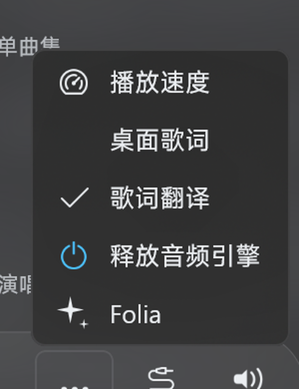
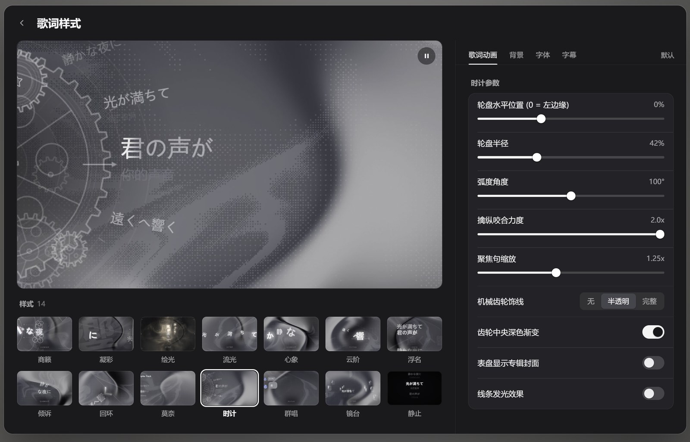
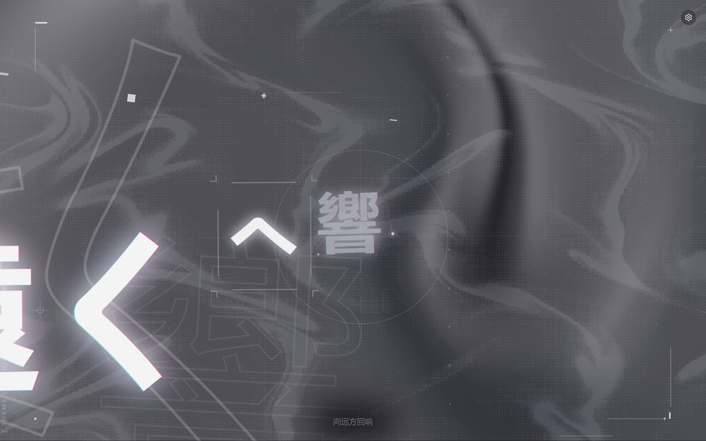
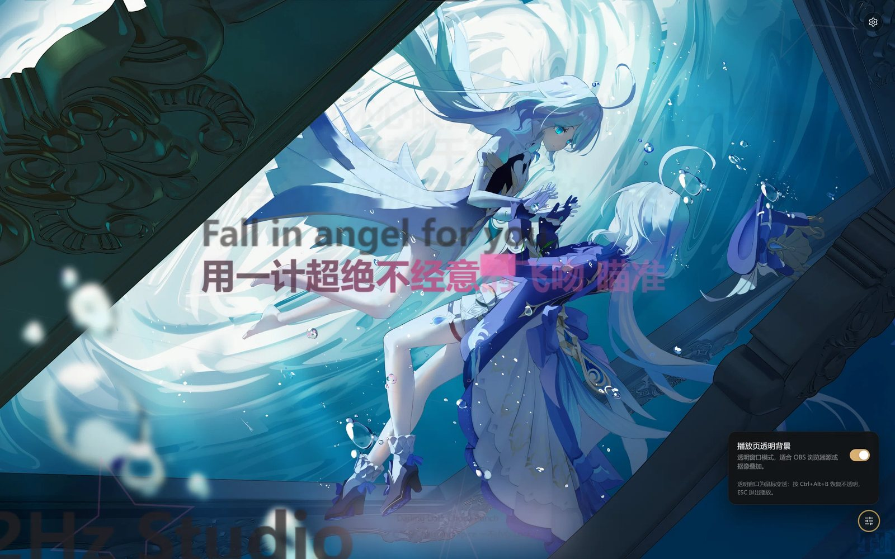
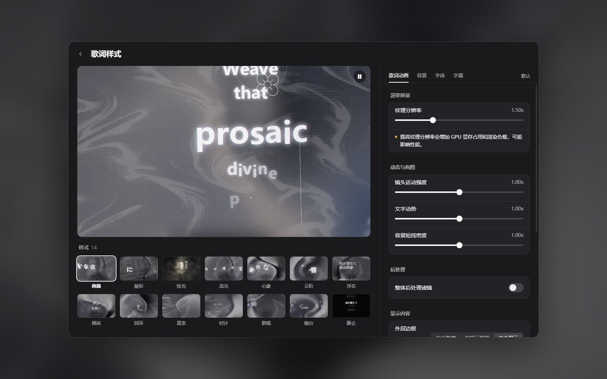
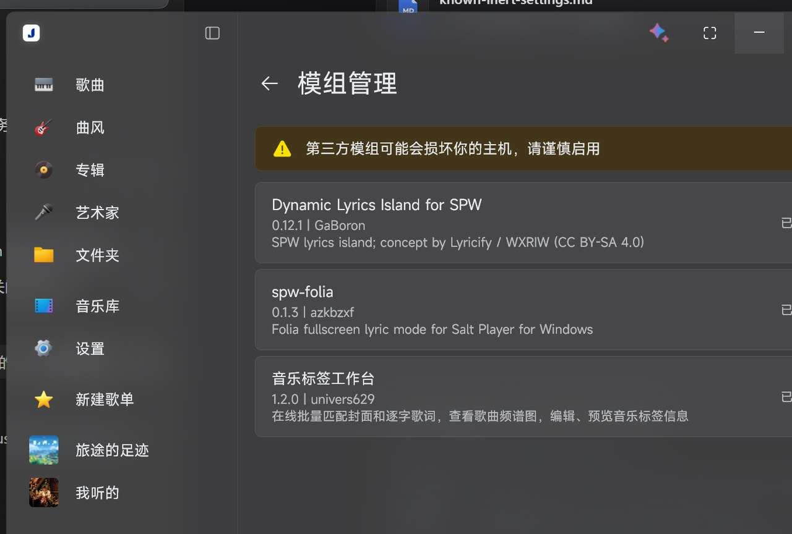
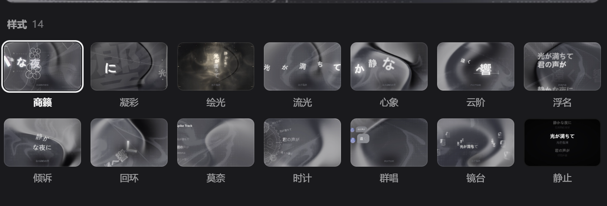

# spw-folia — Salt Player for Windows 的 Folia 歌词可视化插件

把 [Folia](https://github.com/chthollyphile/folia-major) 的歌词可视化系统以创意工坊插件形式带进
**Salt Player for Windows（SPW）**：迷你播放器「更多」菜单里的 `Folia` 条目会打开无边框全屏 Folia
模式，直接运行 Folia **自己的**渲染代码（全部 14 种歌词样式），并由 SPW 正在播放的音乐驱动。

> 与 Folia、Salt Player 均无隶属关系。Folia 采用 AGPL-3.0 许可；本插件是其衍生作品，同样以
> AGPL-3.0 发布（见 [LICENSE](LICENSE) 与 [docs/licensing.md](docs/licensing.md)）。

**中文** | [English](README.en.md)





<p align="center"></p>

<p align="center"></p>

## 功能

- **模组管理作者名**：`azkbzxf`（GitHub 账号，v0.1.3 起）。
- **直接运行真正的 Folia，而非移植** — 插件在 WebView2 中承载 Folia 0.7.21 的生产级
  OBS 浏览器源产物；每种样式都是 Folia 原始代码，因此动态、辉光、逐字时间轴、背景与转场都与
  Folia 像素级一致。
- **全部 14 种歌词样式**：商籁 (sonnet) · 凝彩 (tempera) · 绘光 (lumiere) · 流光 (classic) ·
  心象 (cadenza) · 云阶 (partita) · 浮名 (fume) · 倾诉 (tilt) · 回环 (claddagh) · 莫奈 (monet) ·
  时计 (pendolo) · 群唱 (cappella) · 镜台 (diorama) · 静止 (still)。
- **Folia 设置页 1:1 还原** —「歌词样式」窗口（歌词动画 / 背景 / 字体 / 字幕 四个标签页、
  14 样式实时网格、默认 重置、纹理分辨率、镜头运动强度、文字动势、各样式专属调节项），
  复用 Folia 自己的 React 组件。
- **设置页实时大预览**（v0.1.6）— 「歌词样式」左侧大预览不是静态截图，而是同源 iframe 里的
  真实 Folia 渲染器逐帧绘制：样式、纹理分辨率、镜头运动、字体、背景、主题改动即时生效，
  暂停/播放按钮真正冻结和恢复画面。
- **播放页透明背景**（v0.1.7，v0.1.9 起可切换鼠标穿透）— 全屏播放页右下角的圆形「调音台」按钮里可开关
  「播放页透明背景」：开启后宿主窗口变成真正的透明窗口，Folia 不再绘制背景，歌词与特效直接叠加在桌面或
  其它窗口之上（直播 / OBS 叠加场景）。面板第二行「鼠标穿透（操作桌面）」打开后，点击落向桌面/其它应用，
  而右下角圆钮与右上角齿轮在任何状态下都保持可点。开关随设置树持久化。
- **封面取色** — 主题、背景与强调色由当前歌曲封面派生（v0.1.2 修复），随封面切换实时变化。
- **与 SPW 播放同步** — 歌曲、封面、逐字歌词时间轴、翻译字幕、播放/暂停/跳转/倍速，来自
  SPW 播放 API 加一条平滑插值时间轴。
- **音频响应** — 在原生辅助进程内完成 WASAPI 系统回环采集，输出与 Folia 兼容的 1024-bin 频谱和
  5 段 gamma 映射电平（power/bass/lowMid/mid/vocal/treble）。
- **无 HTTP 服务、无网络** — 辅助进程把本地 bundle 映射到虚拟 https 主机，一个极小的注入 shim
  通过 stdin/stdout 直接把数据喂给 Folia 的 EventSource 协议。
- **AGPL-3.0 完整源码** — 插件（Kotlin）、辅助进程（C#）、设置 UI（React/TS）与打包脚本
  全部在本仓库中。

### v1 限制

- **智能动感的节拍特效未包含在 v1**：Folia OBS 接口不暴露节拍事件，而 Folia 的
  节拍模型（`beat_this` / `htdemucs`，约 133 MB）运行在 Folia 的 Electron 主进程里，不在其 web
  bundle 中。关闭智能动感时（Folia 的默认值），所有样式的渲染与 Folia 完全一致。
  **v0.1.2 / v0.1.3 起设置页陆续移除了所有无法生效的开关与选项**（智能动感、动感效果、罗马音/
  和声字幕、自定义字体、自定义背景、素材上传等）；保留的控件均会产生实际效果。清单见
  [docs/known-inert-settings.md](docs/known-inert-settings.md)。
- **仅支持 Windows**（辅助进程依赖 WebView2 + Windows WASAPI）。
- **锁定 Salt Player for Windows 1.19.0** — 菜单 hook 针对该宿主版本（SPW 内部名称随版本混淆
  变化），在其他版本上插件会拒绝安装 hook。见 [docs/hook-target.md](docs/hook-target.md)。
- 不写入音乐库；插件只读取播放状态与当前歌曲/歌词/封面。
- **透明模式默认会捕获鼠标**：透明窗口整页盖在桌面上，点哪里都先给 Folia（v0.1.8 起页面控件可点）。
  想在透明状态下操作桌面/其它窗口，打开面板里的「**鼠标穿透（操作桌面）**」即可；右下角圆钮与右上角
  齿轮（以及它们打开的面板/设置页）永远可点。也可以按 **Ctrl+Alt+B**（备用 Ctrl+Alt+Y / Ctrl+Alt+P /
  Ctrl+Alt+Shift+B）或 ESC 退出播放。细节见 [docs/live-transparency.md](docs/live-transparency.md)。

## v0.1.11 更新内容

- **修复：打开 Folia 后几秒内窗口必闪退，并可连带 SPW 卡死** — 辅助进程的 stdin 泵跑在后台线程上，但 `lyrics`/`track`/`command` 分支直接调用 `webView.CoreWebView2`（连读属性都在 UI 线程检查之内），必抛 `InvalidOperationException: CoreWebView2 can only be accessed from the UI thread.`，整个 stdin 读取线程就此终止，2 秒后窗口按「插件退出」流程自杀；负载高时被 Windows 判为挂起（Application Hang 1002）强制结束。现在 `PostToPage` 按 `InvokeRequired` 自动封送到 UI 线程，且 stdin 循环改为**逐行**捕获异常——单条坏行只丢该行，泵永不中断。
- **修复：辅助进程停止读取时插件可冻结 SPW** — `FoliaHostBridge.sendLine` 原来在共享监视器内做阻塞式管道写，管道被填满后（155 KB 的 track 消息）写线程永久阻塞并握锁不放，而 `open()` 恰由 Compose UI 线程调用，SPW 主线程随之冻结。现在 stdin 由专职写线程 + 有界队列（满则丢最旧状态行）驱动，SPW 任何线程都不再可能阻塞在管道上。
- 证据链（崩溃现场三条 `Application Hang (1002)`、两次 `InvalidOperationException`、退出码 `0xCFFFFFFF`）与修复前后同脚本复现对比见 [docs/verification-v0.1.11.md](docs/verification-v0.1.11.md)。

## v0.1.10 更新内容

- **修复：透明模式下滚轮向下导致辅助进程崩溃** — v0.1.9 的输入捕获窗口用 `IntPtr.ToInt32()`
  读消息参数；在 x64 上这是带溢出检查的窄化转换，而 Win32 把参数零扩展投递，滚轮向下
  （delta `-120` ⇒ `WPARAM` 低 32 位 `0xFF88xxxx`，bit31 为 1）于是抛出
  `OverflowException: 算术运算导致溢出`，弹出「Microsoft .NET Framework」对话框并退出。
  现改为 `unchecked((int)x.ToInt64())`，并修正滚轮分支取错字段（坐标应取自 `LPARAM`、delta 取自 `WPARAM`）。
- **未处理异常写进日志** — 辅助进程注册 `Application.ThreadException` 与
  `AppDomain.UnhandledException`，今后 UI 线程异常会输出 `level=error` 协议行，不再只有一张弹窗截图。
- 细节见 [docs/verification-v0.1.10.md](docs/verification-v0.1.10.md)。

## v0.1.9 更新内容

- **面板新增「鼠标穿透（操作桌面）」** — 右下角金色圆钮打开的面板里，第二行就是穿透开关（只有透明背景
  开启时出现）。默认关闭：透明窗口仍可点页面（v0.1.8 行为）；打开后点击落向桌面/其它窗口，
  而右下角圆钮、右上角齿轮、它们打开的面板与设置整页仍然可点。
- **两个浮标永远可点** — 页面把自己的热区（圆钮、齿轮、打开中的面板、设置整页）报给宿主，透明窗口上的
  不可见输入捕获窗口只在热区内转发鼠标；热区之外（穿透开启时）改为「合成一次真实左键 → 220 ms 后恢复」，
  所以同一个透明窗口既能点 Folia 又能点桌面。
- **删除左下角 chip** — v0.1.7/v0.1.8 的「恢复不透明背景」浮标窗口已移除，画面不再被额外窗口遮挡；
  **Ctrl+Alt+B** 双向切换保留，退出透明时 `mousePassthrough` 自动复位，下次进入透明不会停留在穿透态。
- 机制见 [docs/live-transparency.md](docs/live-transparency.md)，验证见 [docs/verification-v0.1.9.md](docs/verification-v0.1.9.md)。

## v0.1.8 更新内容

- **切歌即换词** — 之前歌词只在「曲目数据变化」时才推给页面，SPW 自动切歌要等好几秒才换词；
  现在宿主桥每 100 ms 独立比对歌词并推送（真机 track 与 lyrics 相差 ~2 ms），曲目探询也从 1 s 提速到 200 ms。
- **封面/主题跟得上** — 切歌瞬间就发起封面加载（0.4 s 节流、按曲目去重），大封面先缩到 512 px
  再转 data URL；真机从切歌到带封面的 track 约 0.4 s（原来最坏 3–4 s）。页面侧在封面未到时
  保留上一首配色，封面到达后再推导主题，不再闪回默认夜色。
- **透明窗口内可点击** — 透明模式不再「整窗穿透、只能靠热键」：宿主加了一层不可见输入捕获窗口
  （alpha=1/255、`WS_EX_NOACTIVATE`），把鼠标事件转发给 WebView2 的输入子窗口，所以透明时右下角
  圆钮、面板、开关、齿轮都能正常点（真机：透明中点击开关 → 立即恢复不透明）。
- **逃生通道保留** — 左下角 chip 与 **Ctrl+Alt+B** 双向切换仍在，页面卡住时可用；chip 文案改为
  「点开关或 Ctrl+Alt+B 恢复不透明」。
- 机制见 [docs/live-transparency.md](docs/live-transparency.md)，验证见 [docs/verification-v0.1.8.md](docs/verification-v0.1.8.md)。

## v0.1.7 更新内容

- **播放页透明背景** — 全屏播放页右下角新增与 SPW 播放页控制按钮同位置的金色圆形「调音台」按钮，
  点开是「播放页透明背景」开关（布局对齐 SPW 播放页的同一设置项）。开启后窗口变为色键透明窗口、
  Folia 侧 `background.transparent=true` 停止绘制背景，页面底色本就是透明的，因此歌词/特效真正
  叠加在桌面或其它窗口之上，而不是变成纯黑。
- **透明模式的交互兜底** — 色键窗口是鼠标穿透的，所以透明开启后页面内按钮不可点：左下角会出现一个
  不抢焦点的常驻浮标「恢复不透明背景 · Ctrl+Alt+B」，点它或按 **Ctrl+Alt+B**（备用 Ctrl+Alt+Y /
  Ctrl+Alt+P / Ctrl+Alt+Shift+B）一键恢复不透明，同时通过页面钩子把开关同步回「关」、随设置持久化
  （修掉了「退出透明后再次开启无效」的状态不同步问题）；ESC 仍可退出播放。
- **颜色保真** — 色键合成会丢弃 `backdrop-filter` 图层（否则 chrome 在屏幕上整块消失），透明开启时
  chrome 常驻并自动切换到无模糊的 flat 样式；恢复不透明后毛玻璃效果回来。
- **零插件改动** — 新字段 `transparentPlayerBackground` 走现有设置树（插件整树持久化），宿主从
  settings JSON 读取并切换窗口透明度，透明状态在重启后保留。
- 机制与限制见 [docs/live-transparency.md](docs/live-transparency.md)，验证见
  [docs/verification-v0.1.7.md](docs/verification-v0.1.7.md)。


## v0.1.6 更新内容

- **设置页大预览改为真实 Folia 渲染器** — 「歌词样式」左侧大预览不再是一张静态样式帧，而是同源
  `preview.html` iframe 里跑 Folia 自己的 OBS 页面与渲染管线，样式、纹理分辨率、镜头运动、文字
  动势、字体、背景与主题改动即时生效；暂停/播放按钮真正冻结并恢复画面。v0.1.5 的静态帧 Ken Burns
  方案只保留为 iframe 不可用时的 fallback。
- **暂停即完全静止** — 子帧在 `document_start` 用 rAF gate 包装 `requestAnimationFrame`，暂停时
  渲染器/粒子/噪点循环全部停摆，恢复时冲刷队列；设置页关闭（overlay 隐藏）时子帧自动冻结，避免
  隐藏的 1080p 渲染器空转。
- **轻量接入** — 渲染器只在子帧里运行，settings bundle 仅 +12 KB（约 1.06 MB），发布包相对
  v0.1.4 +0.7 MB；4 s 内未就绪自动回退静态帧，连续 5 轮开合复用同一个 iframe、无泄漏。
- **宿主修复** — WebView2 就绪前收到的 `hello`/`settings` 不再触发 `post-page` 空引用；页面重载
  后会回放缓存的歌词/曲目。
- 验证见 [docs/verification-live-preview-ui.md](docs/verification-live-preview-ui.md)（probe
  11/11 PASS，暂停时可见区帧差 ratio 0.00000 / mean 0），与主发布器的接口契约见
  [docs/live-preview-iframe.md](docs/live-preview-iframe.md)。



## v0.1.4 更新内容

- **修复歌词样式预览不随所选样式变化** — 设置页左侧大预览的交叉淡入由 `[src, current]` 依赖的
  effect 驱动，`setCurrent()` 触发重新执行时会取消自己的淡入定时器，导致第一次切换之后新图一直停
  在 opacity 0（旧图不透明）。重写为只依赖目标图的 effect + CSS `spw-preview-in` 淡入（220ms），
  点击任意样式格后大预览/参数面板/高亮立即同步切换，连续切换也不再卡住。
- 验证见 [docs/verification-v0.1.4.md](docs/verification-v0.1.4.md)。

## v0.1.3 更新内容

- **模组管理作者名改为 GitHub 账号** — 插件清单 `Plugin-Provider` 由 `dsh2 team` 改为 **`azkbzxf`**，
  SPW「模组管理」的作者列随之更新。
- **删除全部「有开关但无法生效」的设置** — 继 v0.1.2 移除「智能动感模式」后，v0.1.3 按
  [docs/known-inert-settings.md](docs/known-inert-settings.md) 移除了：动感效果（推镜裂光/涟漪）、
  自定义字体/系统字体、罗马音与和声字幕、自定义/URL 背景，以及凝彩图层图片、莫奈人像、群唱头像/
  表情包等上传类控件（构建期从设置页剥离，不改 Folia 源码）。设置页现在只显示真正生效的控件。
- **修复字体/字幕类设置无效** — 字体族（无衬线/衬线/等宽）与字重现在写入 `theme.fontStyle` /
  `theme.fontWeight`；字幕字体跟随歌词或独立设置都会映射到 `subtitleTheme`；字幕内容模式归一化为
  「翻译」。旧持久化值自动归一化。
- 验证见 [docs/verification-v0.1.3.md](docs/verification-v0.1.3.md)。



## v0.1.2 更新内容

- **修复封面取色** — 插件发送的封面字段是 `coverDataUrl`，设置页却只读 `coverUrl`，导致主题始终
  停留在默认深色。现在宿主同时发送两种拼写、页面侧回退到 `coverDataUrl`，全屏主题/背景/强调色
  随当前封面变化（橙色封面 → 暖色主题；近黑封面 → 中性深色，见
  [docs/images/cover-color.jpg](docs/images/cover-color.jpg) 与
  [docs/verification-v0.1.2.md](docs/verification-v0.1.2.md)）。
- **移除「智能动感模式」开关** — 构建期从设置页剥离该卡片（不影响其它卡片），因为节拍模型不在
  web bundle 中、开关不会有任何效果。
- **整理失效开关清单** — 见 [docs/known-inert-settings.md](docs/known-inert-settings.md)。

## v0.1.1 更新内容

- **更多菜单条目与宿主原生项风格一致** — 与 播放速度 / 桌面歌词 / 歌词翻译 / 释放音频引擎
  相同的行布局：19 dp 星芒图标（使用宿主内容色）、14 sp 文字、相同间距与禁用透明度。
- **修复光标自动隐藏** — 全屏模式中鼠标静止 2.5 秒后隐藏、移动即恢复，歌词样式面板打开期间强制
  显示。（v0.1.0 会永久隐藏光标，导致右上角 ⚙ 无法点击。）
- **设置面板稳定性** — 修复页面↔宿主 UI 状态回环，该问题会导致面板空白/闪烁；现在滚动正确、秒开。

## 端到端验证

发布产物已在 Windows 11 上的真实 Salt Player for Windows 1.19.0（MS 渠道）中验证：

| 检查项 | 证据 |
| --- | --- |
| 迷你播放器「更多」浮层出现 **Folia** 条目，点击后打开全屏渲染器 | [docs/plugin-integration.md](docs/plugin-integration.md) §1, `poc/hook/shots/task7-*` |
| 全屏 3200x2000 @175% DPI，页面 1776x1110 dpr1，3 个 canvas，110-120 fps；16 分钟长稳测试稳定（66-67.5 MB 工作集） | [docs/acceptance-report.md](docs/acceptance-report.md) T8 |
| 播放进度 + 逐字歌词随 SPW 播放推进（100 ms 插值时间轴）；暂停/继续与跳转跟随 | [docs/plugin-integration.md](docs/plugin-integration.md) §1, [docs/acceptance-report.md](docs/acceptance-report.md) T1-T3 |
| 真实鼠标输入：悬停 ⚙ 打开「歌词样式」浮层，← 返回渲染器，ESC 关闭（exit 0） | [docs/acceptance-report.md](docs/acceptance-report.md) T-G1..G3 |
| **更多** 菜单中的 Folia 条目与宿主字体/星芒图标一致（v0.1.1）；**封面取色**随歌曲封面派生主题（v0.1.2，橙/黑纯色封面平均 RGB 165/105/66 vs 71/71/72） | [docs/images/menu-folia.png](docs/images/menu-folia.png), [docs/images/cover-color.jpg](docs/images/cover-color.jpg), [docs/verification-v0.1.2.md](docs/verification-v0.1.2.md) |
| 设置/样式在 SPW 重启后保留；禁用插件后恢复 4 项菜单；5 次开/关与杀掉 SPW 后无残留辅助进程 | [docs/acceptance-report.md](docs/acceptance-report.md) T5-T7, T-E1 |
| v0.1.3：模组管理作者名 = `azkbzxf`；A/B 组失效控件全部移除；字体族/字重/字幕字体在 `pushConfig` 中生效 | [docs/verification-v0.1.3.md](docs/verification-v0.1.3.md) |
| v0.1.4：设置页大预览随样式选择实时切换（本地 harness 6 连点 + 真实 SPW 鼠标点击验证） | [docs/verification-v0.1.4.md](docs/verification-v0.1.4.md) |
| v0.1.6：设置页大预览 = iframe 内真实 Folia 渲染器（3 canvas、暂停帧差 0.00000、切样式即时生效、5 轮开合复用同一 iframe、0 页面错误） | [docs/verification-live-preview-ui.md](docs/verification-live-preview-ui.md) |
| v0.1.7：播放页透明背景（色键窗口真透明、桌面透出、左下浮标/ Ctrl+Alt+B 恢复不透明并同步页面开关、退出后再次开启正常、设置树持久化、ESC 退出、透明时 chrome 可见） | [docs/verification-v0.1.7.md](docs/verification-v0.1.7.md) |
| v0.1.8：切歌即换词（track/lyrics 相差 2 ms）、封面 0.2 s 缩图并 0.4 s 内到页面、无封面保留旧主题；透明窗口内鼠标可点（透明中点开关 → `mode=off` + catcher 隐藏） | [docs/verification-v0.1.8.md](docs/verification-v0.1.8.md) |
| v0.1.9：鼠标穿透开关（`passthrough=on rects=3` → 点桌面 `passthrough=click at=1600,560` → catcher 恢复）、穿透下圆钮/齿轮/设置页返回键可点、热键退出后 `mode=off` + `passthrough=off` | [docs/verification-v0.1.9.md](docs/verification-v0.1.9.md) |
| v0.1.10：滚轮向下崩溃修复（旧二进制投递 `WM_MOUSEWHEEL wparam=0xFF880000` 必抛 `OverflowException` 并弹出「Microsoft .NET Framework」对话框；新二进制反射级 15/15、真机级 0 弹窗、0 error 日志） | [docs/verification-v0.1.10.md](docs/verification-v0.1.10.md) |
| v0.1.11：stdin 泵跨线程访问 WebView2 崩溃修复（旧二进制收到 `lyrics` 后 30 ms 内抛 `InvalidOperationException` 并 2 s 后自杀，`statesReceived` 停在 32；新二进制 0 error、`statesReceived=96`、`quit` 正常送达退出码 0） | [docs/verification-v0.1.11.md](docs/verification-v0.1.11.md) |
| 发布产物中全部 14 种样式均可渲染（15/15 扫描，0 页面错误，0 外部网络请求）；在干净目录解包的 RC 产物通过 19/19 布局/协议检查 | [docs/release-candidate.md](docs/release-candidate.md) |
| 完整验收矩阵（切歌 / 跳转 / 暂停 / 无歌词 / 生命周期 / 持久化 / 长稳） | [docs/acceptance-run.md](docs/acceptance-run.md), [docs/acceptance-report.md](docs/acceptance-report.md) |

<p align="center"></p>

## 安装

要求：Windows 10/11 x64、**Salt Player for Windows 1.19.0**、WebView2 Runtime（Windows 11 已内置；
Windows 10 需安装 “Microsoft Edge WebView2 Runtime”）。

1. 从 [Releases](https://github.com/azkbzxf/spw-folia/releases) 页面下载 `spw-folia-0.1.11.spmod`（Windows x64）。
2. 在 SPW 中：**设置 → 插件 / 创意工坊 → 导入插件**，选择该 `.spmod`，启用它，并在询问时授予
   **class-transform**（「钩子」）权限（更多菜单 hook 需要）。
3. 若插件管理器提示需要，重启 SPW。
4. 播放歌曲，打开迷你播放器的 **更多**（…）菜单 → **Folia**。

首次运行会打开 Folia 设置窗口；之后会直接打开可视化器（右上角 ⚙ 打开设置；ESC 先关设置、再关窗口）。
设置保存在 SPW 的插件数据目录中。

## 从源码构建

工具链：JDK 25、Gradle 9.8（含 wrapper）、Kotlin 2.4.20、Node 24 + pnpm（设置 UI）、
Windows 自带 `csc.exe`（.NET Framework 4.8，用于原生辅助进程）。无需 .NET SDK，无需 Android SDK。

```bat
:: 1) 插件（Kotlin，官方 SPW 创意工坊 Gradle 插件）
cd spw-folia
gradlew.bat plugin          :: -> build/libs/plugin-dev.spw.folia-0.1.10.spmod

:: 2) 原生辅助进程（C# + WebView2）
cd ..\poc\webview\host
bash build.sh               :: -> build/spw-folia-host.exe (+ WebView2 dlls)

:: 3) 设置 UI（React）
cd ..\..\settings-ui
pnpm install && pnpm build  :: -> dist/settings-ui.js

:: 4) 组装可分发 .spmod（插件 classes + 暂存 web bundle + 原生进程 + 许可证）
bash packaging/build-package.sh     :: 暂存 packaging/{web,native,licenses} + SHA256SUMS
python packaging/tools/assemble-release.py ^
    --spmod spw-folia/build/libs/plugin-dev.spw.folia-0.1.10.spmod ^
    --staging packaging --out dist/release --name spw-folia-0.1.11.spmod
::    完整脚本化组装与本地安装测试流程见 docs/release.md。
```

项目结构：

```
spw-folia/       Kotlin 插件（hook、播放桥接、时间轴、配置、辅助进程管理）
poc/webview/     原生辅助进程源码（C# WinForms + WebView2）与开发服务器/驱动
poc/settings-ui/ Folia 设置窗口（复用 Folia 组件的 React island）
poc/audio/       WASAPI 回环分析器（C#）+ 时间轴说明
packaging/       暂存的 web bundle + 原生 payload + 许可证 + 发布文档
docs/            架构、协议、宿主程序、hook 目标、Folia 规格、许可
research/        Folia 样式/设置调研笔记（AGPL；参考素材不提交到仓库）
```

## 架构（简版）

```
SPW (JVM)                                    spw-folia-host.exe (C#/WebView2)
┌──────────────────────────┐  stdin/stdout   ┌───────────────────────────────────┐
│ spw-folia 插件           │  JSON-lines     │ 无边框全屏窗口                    │
│  MenuHook（更多 → Folia）│ ──────────────▶ │  Folia OBS bundle (React)         │
│  PlaybackBridge ────────▶│ state/lyrics/   │  注入的 EventSource shim          │
│  Timeline（平滑进度）    │ track/settings  │  注入的 Folia 设置 UI             │
│  ConfigStore             │ ◀────────────── │  WASAPI 回环 → 音频帧             │
└──────────────────────────┘ ready/closed/…  └───────────────────────────────────┘
```

详见：[docs/architecture.md](docs/architecture.md) · 通信协议：
[docs/protocol.md](docs/protocol.md) · 原生宿主：[docs/host-app.md](docs/host-app.md) ·
Folia 规格：[docs/folia-spec/](docs/folia-spec/) · 许可：[docs/licensing.md](docs/licensing.md)。

## 致谢

- [Folia](https://github.com/chthollyphile/folia-major)，作者 chthollyphile（AGPL-3.0）——整个
  可视化器、设置 UI 与 web bundle 都来自 Folia 的工作（v0.7.21）。
- [Salt Player for Windows](https://saltplayer.com/) 创意工坊插件 API，作者 Moriafly。
- [spw-island（Dynamic Lyrics Island for SPW）](https://github.com/gaboron/spw-island) ——
  仅作为行为参考（GPL-3.0）；未复制任何代码。
- Microsoft Edge WebView2 SDK、.NET Framework、Kotlin/Compose、React/Vite。

## 许可

AGPL-3.0-or-later。本仓库包含 Folia 的衍生作品，分发时希望它有用，但不提供任何担保。见
[LICENSE](LICENSE)、[THIRD_PARTY_NOTICES.md](THIRD_PARTY_NOTICES.md) 以及
[docs/licensing.md](docs/licensing.md) 中的源码提供说明。
